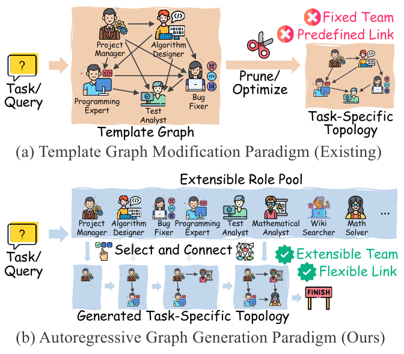
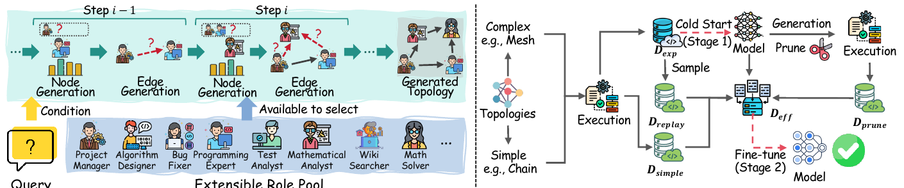
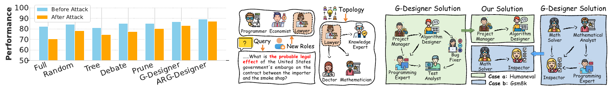
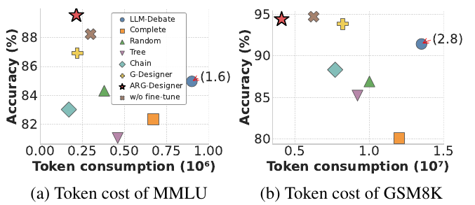

# 论文阅读笔记：Assemble Your Crew（ARG-Designer）

> **论文**：*Assemble Your Crew: Automatic Multi-agent Communication Topology Design via Autoregressive Graph Generation*
> **作者**：Shiyuan Li, Yixin Liu, Qingsong Wen, Chengqi Zhang, Shirui Pan（AAAI 2026 Oral）
> **链接**：[arXiv:2507.18224](https://arxiv.org/abs/2507.18224) · [代码](https://github.com/Shiy-Li/ARG-Designer)
> **配图**：下文图片均截取自原论文，论文以 [CC BY 4.0](https://creativecommons.org/licenses/by/4.0/) 许可发布，版权属原作者。
>
> 本笔记按"**我读的时候提的问题**"来组织：每个关键点先给论文怎么说，再记下当时的疑问和结论，最后对照代码。凡是写着"（代码核对）"的地方，都是我读了仓库代码后得到的判断；标"待核实"的是还没验证的。

---

## 0. 一页纸看懂

**一句话**：以前的方法是"先摆一张满编大图，再剪边"；这篇论文改成"**像招人组队一样，从零开始一个一个加 agent，并决定它和已有成员怎么连线**"。

| | 以前（模板图修改） | ARG-Designer（自回归生成） |
|---|---|---|
| 起点 | 一张预设的大图（固定成员、固定连线） | 空图 |
| 操作 | 剪边 / 调权重 | 逐步加节点、加边 |
| agent 数量 | 固定 | 模型自己决定（选到 `END` 就停） |
| 角色 | 固定一套 | 从"可扩充的角色池"里挑 |
| 训练数据 | 不需要标准图 | 自动造（冷启动 + 精简两轮） |

**读之前先说明几个初学者容易混的点**：

1. 被训练的模型是一个**很小的 GRU 网络**，不是大语言模型；`gpt-4o` 之类只是团队里"干活的 agent"，不被训练。
2. 训练数据是 **（题目，一张协作图）**，不是（题目，答案）。
3. 论文里说的"两个阶段（Stage 1 / Stage 2）"指**两轮训练**；仓库 README 里的"三阶段"指**三个脚本**（造数据、训练、评测）。两者不是一回事。

---

## 1. 要解决的问题：模板图修改范式有两个缺陷



*（原论文 Figure 1）上：现有方法从一张预设模板图出发剪枝；下：本文方法从角色池里一步步选择并连线。*

论文指出模板修改范式有两个问题：

- **缺陷 1：冗余组成。** 为了灵活，模板图往往塞进很多角色、连很多边，其中大部分对某道具体题目没用。剪枝也剪不干净，既浪费 token，也可能干扰决策。
- **缺陷 2：难以扩展。** 模板是在固定角色集合上训练的。新出现一种 agent 能力时，要么重训，要么把模板做得极大再剪，代价过高。

> **我的理解**：缺陷 1 是"人太多"，缺陷 2 是"人换不了"。自回归生成对应地解决它们：不预先放人（所以不会冗余），角色用"检索"的方式选（所以新角色可以加）。

---

## 2. 问题形式化

### 2.1 把 MAS 看成协作图

一个多智能体系统（MAS）被建模为**有向无环图（DAG）**：

```math
G=(V,E),\qquad V=\{v_1,\dots,v_N\}
```

- 节点 $`v_i`$：一个 agent，本质是一个带有**角色** $`r_i\in\mathcal{R}`$ 和**内部状态** $`s_i`$ 的 LLM 实例。
- 边 $`e_{ji}=(v_j,v_i)`$：$`v_j`$ 的输出要传给 $`v_i`$。
- $`N_{\text{in}}(v_i)=\{v_j\mid (v_j,v_i)\in E\}`$：$`v_i`$ 的所有"上游"。

### 2.2 协作协议：图怎么跑起来

按拓扑排序依次激活 agent（保证一个 agent 运行时，它的上游输出都已就绪），共进行 $`K`$ 轮。第 $`k`$ 轮里 agent $`v_i`$ 的输出是

```math
m_i^{(k)}=\mathrm{LLM}_i\big(P_i^{(k)}\big),\qquad P_i^{(k)}=f\big(r_i,\;s_i,\;Q,\;\{m_j^{(k-1)}\mid v_j\in N_{\text{in}}(v_i)\}\big)
```

即：提示词由"自己的角色和记忆 + 题目 $`Q`$ + 上游 agent 上一轮的输出"拼成。最后由聚合函数得到答案：

```math
O=\mathrm{Aggregate}\big(\{m_i^{(K)}\mid v_i\in V\}\big)
```

聚合可以是多数投票、交给某个终结 agent，或取最后一个 agent 的输出。

> **对照代码（代码核对）**：这部分在 `mas_framework/graph/graph.py` 的 `Graph.run` 里，用入度队列做拓扑排序；"终结 agent"对应代码里的 `decision_node`（HumanEval 用 `FinalWriteCode`）。论文实验设 $`K=3`$，但我看到的 HumanEval 脚本里 `num_rounds` 默认/写死为 1，需要在其他数据集脚本里再确认。

### 2.3 设计目标：学一个"条件生成模型"

直接在所有图里搜索"最好的图"代价太高。论文改为学习一个条件分布，取最可能的图：

```math
G^{*}=\arg\max_{G\in\mathcal{G}}\;P(G\mid Q,\mathcal{R})
```

### 2.4 自回归分解：一次只做一个简单决定

```math
P(G\mid Q,\mathcal{R})=\prod_{i=1}^{|V|}\Big[\underbrace{P\big(v_i\mid G_{<i},Q,\mathcal{R}\big)}_{\text{选第 }i\text{ 个角色}}\;\prod_{j=1}^{i-1}\underbrace{P\big(e_{ji}\mid v_i,G_{<i},Q\big)}_{\text{决定要不要连边}}\Big]
```

- $`G_{<i}`$：已经搭好的前 $`i-1`$ 个节点的"半成品图"。
- 外层乘积：一个一个加节点；内层乘积：对新节点，逐个决定和前面每个节点之间有没有边。
- "什么时候停"：模型学会采样一个特殊的 `END` 符号。

> **阅读提示**：这个公式的"套路"和语言模型一样，把联合概率拆成一串条件概率；区别只是"每一步选的东西"从"下一个词"换成了"下一个角色 + 它的连边"。

---

## 3. 模型结构：一个层级 GRU



*（原论文 Figure 2）左 (a)：生成过程，每一步先"节点生成"再"边生成"，候选来自可扩充的角色池；右 (b)：训练过程，两阶段数据。*

### 3.1 先回答一个最常见的疑问

> **Q：最后是一个 GRU，GRU 能生成文本吗？**
>
> **A：GRU 在这里完全不生成文本。** 它的输入是一个数字向量（题目被冻结的句向量模型压缩而成），输出是"选哪个角色、连不连边"这样的**离散选择**。写文字和代码的是团队里的 LLM。可以把 ARGDesigner 看成"排兵布阵的指挥官"，LLM 是"上场的士兵"。
>
> GRU 是一种循环网络，每步读入输入 $`x_t`$，结合上一步记忆 $`h_{t-1}`$ 更新记忆：$`h_t=\mathrm{GRU}(x_t,h_{t-1})`$。**它吐出什么，取决于后面接什么分类层**：接词表就是语言模型，接角色池就是选角色。
>
> | | 语言模型生成文本 | ARGDesigner 生成图 |
> |---|---|---|
> | 每步选什么 | 下一个词 | 下一个角色（或 `END`） |
> | 候选集合 | 几万个词 | 角色池（HumanEval 只有 5 个角色）+ `END` |
> | 概率 | $`P(w_t\mid w_{<t})`$ | $`P(v_i\mid G_{<i},Q,\mathcal{R})`$ |
>
> **为什么偏偏用 GRU？** 论文给的理由是 GRU 擅长序列、计算量小。结合场景，我的理解还有：序列极短（十来个 agent）、训练数据极少（几十条）、设计团队这一步不该再花大模型的钱。论文的相关工作里还点名了 GraphRNN（You et al. 2018）等"自回归图生成"的前人工作，ARG-Designer 属于这条路线。

### 3.2 输入表示

题目 $`Q`$ 和每个候选角色 $`r_k`$ 都先用同一个预训练句向量模型（实验里是 `all-MiniLM-L6-v2`，$`d=384`$）编码：

```math
f_Q=\mathrm{FFN}\big(\mathrm{LN}(\mathrm{SentenceEncoder}(Q))\big),\qquad z_{r_k}=\mathrm{SentenceEncoder}(r_k)
```

所有角色向量堆成矩阵 $`Z\in\mathbb{R}^{|\mathcal{R}|\times d}`$，是"可选人员的知识库"。

### 3.3 节点生成器：选下一个角色

**第一步，历史向量**：用一个 GRU 把已选角色的向量压成一个向量：

```math
f_{\text{hist}}^{(i)}=\mathrm{GRU}_{\text{prev}}\big([z_{r_1},z_{r_2},\dots,z_{r_{i-1}}]\big)
```

**第二步，用"门"混合历史和题目**：

```math
f_{\text{cont}}^{(i)}=(1-g_i)\cdot f_{\text{hist}}^{(i)}+g_i\cdot f_Q,\qquad g_i=\sigma\!\Big(\frac{f_{\text{hist}}^{(i)}\cdot f_Q}{\sqrt{d}}\Big)
```

$`g_i`$ 是 0 到 1 的数：历史和题目越"相关"，题目的权重越大。

**第三步，更新节点级记忆**（$`f_{\text{edge}}^{(i)}`$ 编码上一个节点的连边模式）：

```math
h_{\text{node}}^{(i)}=\mathrm{GRU}_{\text{node}}\Big(\mathrm{MLP}_{\text{node}}\big([f_{\text{cont}}^{(i)},f_{\text{edge}}^{(i)}]\big),\;h_{\text{node}}^{(i-1)}\Big)
```

**第四步，选角色**（度量学习式检索）：

```math
s_{\text{node}}^{(i)}=\mathrm{MLP}_{\text{pred\_n}}\big(h_{\text{node}}^{(i)}\big)\cdot\mathrm{MLP}_{\text{role}}\big([Z,\;z_{\text{end}}]\big)^{\!\top},\qquad P\big(v_i\mid G_{<i},Q,\mathcal{R}\big)=\mathrm{softmax}\big(s_{\text{node}}^{(i)}\big)
```

> **Q：角色是离散的，向量是连续的，所以这是个分类任务吗？向量怎么和角色对应？**
>
> **A：是分类，但不是普通分类。**
>
> - **离散 → 连续**：查表。每个角色有一个向量（由它的文字描述编码得到）。
> - **连续 → 离散**：算相似度 → softmax 变概率 → 抽样出一个整数编号，再用 `id_to_role` 查出角色名。
>
> 普通分类的最后一层是 $`\text{logits}=Wh+b`$，$`W`$ 的每一行是"该类的模板"，是训练出来的参数，类别数 $`K`$ 一旦定了就不能变。
> 这里**没有"每类模板"这个参数矩阵**：GRU 先输出一个"我想要什么样的角色"的向量 $`q^{(i)}`$，每个候选的模板 $`r_k=\mathrm{MLP}_{\text{role}}(z_k)`$ 是**由它的文字描述现算出来的**，打分是点积 $`s_k=q^{(i)}\cdot r_k`$。这叫**度量学习 / 检索式分类**。
>
> 类比：普通分类是"答题卡"，选项印死了；这里是"挑名片"，心里有理想人选的画像，拿桌上每张名片去比对，最像的胜出，桌上多放一张名片就能参与比较。
>
> 玩具例子（二维向量，$`q=(0.9,0.1)`$）：
>
> | 候选 | 向量 $`r_k`$ | 点积 | softmax |
> |---|---|---|---|
> | 项目经理 | $`(1,0)`$ | $`0.9`$ | $`0.41`$ |
> | 程序员 | $`(0,1)`$ | $`0.1`$ | $`0.19`$ |
> | 测试员 | $`(0.7,0.7)`$ | $`0.7`$ | $`0.34`$ |
> | `END` | $`(-1,-1)`$ | $`-1.0`$ | $`0.06`$ |
>
> 然后按概率抽样（代码里是 `torch.multinomial`，不是直接取最大）。

### 3.4 边生成器：新节点连谁

新节点 $`v_i`$ 确定后，另一个 GRU 逐个检查前面的节点 $`v_1,\dots,v_{i-1}`$，决定"要不要接收它的输出"。边 GRU 的初始状态来自节点级 GRU：

```math
h_{\text{edge}}^{(i,0)}=\mathrm{MLP}_{\text{node2edge}}\big(h_{\text{node}}^{(i)}\big),\qquad h_{\text{edge}}^{(i,j)}=\mathrm{GRU}_{\text{edge}}\Big(\mathrm{MLP}_{\text{edge}}\big(\mathbf{e}^{(j-1,i)}\big),\;h_{\text{edge}}^{(i,j-1)}\Big)
```

```math
s_{\text{edge}}^{(i,j)}=\mathrm{MLP}_{\text{pred\_e}}\big(h_{\text{edge}}^{(i,j)}\big),\qquad P\big(e_{j,i}=1\mid v_i,G_{<i},Q\big)=\sigma\big(s_{\text{edge}}^{(i,j)}\big)
```

其中 $`\mathbf{e}^{(j-1,i)}`$ 是上一个连边决定的 one-hot 向量。这就是"**层级**"的含义：节点 GRU 在外层，边 GRU 在内层。

---

## 4. 新角色从哪来？

> **Q：新角色怎么生成？**
>
> **A：ARGDesigner 不"生成"角色，它只从角色池里选。** 角色池由人（加 LLM）设计：论文实现细节里说用 GPT-4 来生成这些角色档案（profile pool）。
>
> **角色在技术上是什么？** 就是**一个名字加一段描述文字**。HumanEval 的角色池是手写字典 `ROLE_DESCRIPTION`，只有 5 个角色：Project Manager、Algorithm Designer、Programming Expert、Test Analyst、Bug Fixer。agent 的类（`CodeWriting`）是通用的，不同角色的唯一差别就是**系统提示词不同**（`system_prompt = self.constraint`）。
>
> **同一段文字被用了两次**：① 编码成向量，让 ARGDesigner 比较、选择；② 当作系统提示词，告诉 LLM "你是谁"。所以向量表示的正是 agent 实际被告知的那段话。
>
> **加一个新角色（如 "Lawyer"）要做的事**：
>
> 1. 写一段描述（人写，或让 LLM 写）；
> 2. 登记进角色字典，agent 才能把它当系统提示词；
> 3. 算向量，追加到矩阵：$`Z\leftarrow\begin{bmatrix}Z\\ z_{\text{Lawyer}}^{\top}\end{bmatrix}`$；
> 4. 照常生成。

### 为什么没训练过也可能被选中

论文的"可扩展性讨论"：因为选角色用的是**相似度检索**而不是固定维度的分类头，所以推理时直接给 $`Z`$ 追加新行即可，无需重训。题目是法律题时，GRU 输出的 $`q`$ 指向"法律相关"，而新角色的向量天然在这一区域，点积大，就有机会被选中。



*（原论文 Figure 4）(a) 提示词注入攻击下的性能；(b) MMLU 上加入新角色 Lawyer 后，模型把律师放在图的核心；(c) 与 G-Designer 的案例对比。*

> **⚠️ 保持怀疑**
>
> 1. **证据偏弱**：我看到的段落里，扩展性只有 **MMLU 上一个法律题的定性案例**（图 4b），没有对多个新角色做系统的量化实验。"能用"有一个例子，"总是好用"没有被证明。
> 2. **取决于泛化**：新角色的向量要经过只在旧角色上训练过的 $`\mathrm{MLP}_{\text{role}}`$，对没见过的向量怎么变换，没有保证。
> 3. **（代码核对）仓库里没有现成的"新增角色"接口**：角色矩阵在初始化时按训练时的角色表建好，并随权重一起保存。想加新角色，需要自己重建矩阵，并保证 `role_to_id`、`id_to_role`、`ROLE_DESCRIPTION` 三处一致。我读了代码，但没有实际跑过。

---

## 5. 训练：课程学习与两轮数据


*（再看 Figure 2(b)）复杂拓扑 → 执行 → $`D_{exp}`$（冷启动，Stage 1）；再生成并剪枝、加简单拓扑、重放 → $`D_{eff}`$（精简微调，Stage 2）。*

### 5.1 阶段一：冷启动数据集（D_exp）

```math
\mathcal{D}_{\text{exp}}=\Big\{\big(G(c),\,Q\big)\;\Big|\;Q\in\mathcal{Q}_{\text{base}},\;c\in\mathcal{C}_{\text{complex}},\;S\big(Q,G(c)\big)=1\Big\}
```

- $`c`$：**配置蓝图**，如（拓扑=网状，人数=4，角色池）。
- $`G(c)`$：按蓝图**确定性**建出来的图。
- $`S(Q,G)\in\{0,1\}`$：这张图做对题目就是 1。

> **Q：标准答案是 LLM 生成很多个，再用 benchmark 选出最优的吗？**
>
> **A：不是，有两处要纠正。**
>
> 1. **团队图不是 LLM 生成的，是人写的规则 + 随机角色。** 拓扑和人数由 `get_unique_complex_configs_*()` 写死，每个 agent 的角色是 `random.choices(角色池, k=人数)` 随机抽的；LLM 只在团队里"干活"（写代码、推理）。
> 2. **没有"选出最优"，只有"过滤出成功"。** 每道题 × 每种配置只跑一次，做对就保存，做错就丢。同一道题可能有多张图都做对，都留下。所以这些图是"**能行**"的，不是"**最优**"的。
>
> 这个"标准答案"有两处不可靠：① 有运气成分（LLM 输出会变，一次做对不代表团队真合适）；② 做对不等于每个成员都有用。这正是论文要再做一轮"效率微调"的原因。
>
> 一条训练样本 = （题目文字，一张"角色 + 连边"的图）。不包含 GPT 的回答或代码答案。
>
> **（代码核对）训练数据不在仓库里**：仓库只有题库（`datasets/*.jsonl`），训练数据要运行 `cold_start_*.py` 生成。按 README 的命令，HumanEval 训练题 $`4\times10=40`$ 道，其中 40% 即 16 道用来造冷启动数据，冷启动 5 种配置最多产生 $`5\times16=80`$ 张图，过滤后更少。数据规模很小，论文也说只用 40 到 60 道题训练。

**为什么用复杂的图起步？** 复杂图沟通充分，更容易做对，能攒到更多成功样本。论文称之为解决**冷启动（cold start）**问题：先让模型学到"组队的基本套路"。

### 5.2 阶段二：效率数据集（D_eff）

```math
\mathcal{D}_{\text{eff}}=\mathcal{D}_{\text{simple}}\;\cup\;\mathcal{D}_{\text{pruned}}\;\cup\;\mathcal{D}_{\text{replay}}
```

| 部分 | 含义 | 为什么需要 |
|---|---|---|
| $`\mathcal{D}_{\text{simple}}`$ | 手工验证过的天然精简配置（链、星形、分层）生成的图 | 提供"够用就好"的正面例子 |
| $`\mathcal{D}_{\text{pruned}}`$ | 取第一阶段模型生成的臃肿图，系统地删节点或边，删完仍成功的保留 | 让模型从自己的输出里学会精简 |
| $`\mathcal{D}_{\text{replay}}`$ | 从 $`\mathcal{D}_{\text{exp}}`$ 随机抽一部分 | 防止**灾难性遗忘** |

> **Q：$`\mathcal{D}_{\text{simple}}`$ 怎么得到？"天然精简"和预训练阶段用的框架有什么区别？**
>
> **A：用的是完全同一个 MAS 框架（`Graph` 类），区别只在连边方式和人数。**
>
> | | 冷启动（预训练用） | $`\mathcal{D}_{\text{simple}}`$ |
> |---|---|---|
> | 拓扑 | `FullConnected`、`Mesh` | `Chain`、`Star`、`Layered` |
> | 人数 | 3 到 5 | 2 到 5 |
> | 题目 | `base` 那一批 | `finetune` 那一批 |
> | 建图、判分、保存 | 同一套代码 | 同一套代码 |
>
> "精简"省在**边的数量**：每条边意味着一个 agent 要读另一个 agent 的完整输出，这些文字都进提示词，多花 token。实际建出的边数（有向无环）约为
>
> ```math
> \underbrace{\binom{N}{2}=\frac{N(N-1)}{2}}_{\text{全连接}}\quad\text{对比}\quad\underbrace{N-1}_{\text{链、星形}}
> ```
>
> 例如 $`N=5`$：全连接 10 条边，链或星形只有 4 条。

### 5.3 训练目标

最大化标准图的对数似然（负对数似然损失），并拆成节点和边两项加权：

```math
\mathcal{L}(\theta)=-\sum_{(G,Q)\in\mathcal{D}}\log P_\theta(G\mid Q),\qquad \mathcal{L}_{\text{total}}=\alpha\,\mathcal{L}_{\text{node}}+(1-\alpha)\,\mathcal{L}_{\text{edge}},\;\;\alpha=0.2
```

```math
\mathcal{L}_{\text{node}}=-\sum_{(G,Q)\in\mathcal{D}}\sum_{i=1}^{|V|}\log P_\theta\big(v_i\mid G_{<i},Q,\mathcal{R}\big),\qquad \mathcal{L}_{\text{edge}}=-\sum_{(G,Q)\in\mathcal{D}}\sum_{i=1}^{|V|}\sum_{j=1}^{i-1}\log P_\theta\big(e_{ji}\mid v_i,G_{<i},Q\big)
```

训练用 **teacher forcing**：每一步都喂标准图的真实历史，而不是模型自己上一步的预测，这样训练更稳更快。

两轮训练：先在 $`\mathcal{D}_{\text{exp}}`$ 上冷启动训练，再在 $`\mathcal{D}_{\text{eff}}`$ 上用**更低的学习率**微调（代码里 $`8\times10^{-5}\to1\times10^{-5}`$）。

---

## 6. 推理：Algorithm 1

给定新题目 $`Q`$，**不需要任何标准答案**，从空图开始：

1. 采样角色 $`r_i\sim P_\theta(v_i\mid G_{<i},Q)`$；
2. 若 $`r_i=\texttt{END}`$ 或 $`i>N_{\max}`$，停止；
3. 否则加入节点 $`v_i`$；
4. 对 $`j=i-1,\dots,1`$，采样边 $`b_{ji}\sim P_\theta(e_{ji}\mid v_i,G_{<i},Q)`$，$`b_{ji}=1`$ 就加边；
5. $`i\leftarrow i+1`$，回到 1。

> **（代码核对）真实代码比伪代码多了不少"修补逻辑"**（`ARGDesigner.sample`）：前 `min_num_node`（默认 2）步禁止选 `END`；若新节点一条入边都没有，**随机补一条**；有环就删边；图不连通就强行连起来；孤立点也随机连一个。这些在论文里没有提，但会影响最终生成的图，复现时要知道。待 L07 逐行核实。

---

## 7. 实验结果

### 7.1 六个基准上的准确率（Table 3）

| 方法 | MMLU | GSM8K | AQuA | MultiArith | SVAMP | HumanEval | 平均 |
|---|---|---|---|---|---|---|---|
| Vanilla | 80.39 | 82.30 | 71.06 | 93.09 | 86.55 | 71.39 | 80.80 |
| CoT | 81.69 | 86.50 | 73.58 | 93.25 | 87.36 | 74.67 | 82.84 |
| SC (CoT) | 83.66 | 81.60 | 75.63 | 94.12 | 88.59 | 79.83 | 83.91 |
| Chain | 83.01 | 88.30 | 74.05 | 93.27 | 87.17 | 81.37 | 84.53 |
| Tree | 81.04 | 85.20 | 71.23 | 93.68 | 88.91 | 80.53 | 83.43 |
| Complete | 82.35 | 80.10 | 72.95 | 94.53 | 84.01 | 79.03 | 82.16 |
| Random | 84.31 | 86.90 | 76.48 | 94.08 | 87.54 | 82.66 | 85.33 |
| LLM-Debate | 84.96 | 91.40 | 77.65 | 96.36 | 90.11 | 84.70 | 87.53 |
| AgentPrune | 85.07 | 91.10 | 80.51 | 94.65 | 90.58 | 86.75 | 88.09 |
| AgentDropout | 85.62 | 91.70 | 80.94 | 95.60 | 91.04 | 85.98 | 88.48 |
| G-Designer | 86.92 | 93.80 | 81.60 | 96.50 | 93.10 | 88.33 | 90.04 |
| **ARG-Designer** | **89.54** | **94.40** | **86.45** | **98.93** | **95.63** | **91.74** | **92.78** |

*（数字转录自原论文 Table 3，指标：MMLU/GSM8K/AQuA/MultiArith/SVAMP 为准确率，HumanEval 为 Pass@1。）*

读表的几个观察：

- 在 AQuA 上比最强的学习型基线 G-Designer 高 $`86.45-81.60=4.85`$ 个点。
- 把"全连接（Complete）"和"链（Chain）"对比：边更多反而不一定更好（GSM8K 上 Complete 80.10 低于 Chain 88.30），说明**沟通不是越多越好**，这正是"自适应拓扑"的动机。

### 7.2 Token 效率（Figure 3）



*（原论文 Figure 3）横轴是 token 消耗，纵轴是准确率；左上角越好。星形为 ARG-Designer，叉号为不做精简微调的变体。*

- 论文文字：GSM8K 上 ARG-Designer 只用约 $`4.1\times10^{6}`$ token 就达到 94.40%，比 G-Designer 约少一半 token。
- **精简微调的价值**：MMLU 上，微调把准确率从 88.23% 提到 89.54%，同时 token 少了近 30%；GSM8K 上 token 从 $`6.25\times10^{6}`$ 降到 $`4.1\times10^{6}`$。

### 7.3 消融实验（Table 4）

| 变体 | MMLU | GSM8K | HumanEval | 平均 |
|---|---|---|---|---|
| Vanilla | 80.39 | 82.30 | 71.39 | 78.02 |
| **ARG-Designer** | **89.54** | 94.40 | **91.74** | **91.89** |
| w/o fine-tune | 88.23 | **94.70** | 90.91 | 91.28 |
| w/o task emb. | 86.93 | 93.10 | 89.26 | 89.76 |
| w/o hist. emb. | 88.23 | 93.60 | 90.08 | 90.64 |

- **去掉题目向量 $`f_Q`$ 掉得最多**（平均 91.89 → 89.76），说明"根据题目定制"最关键。
- **去掉精简微调，准确率几乎不变**（GSM8K 上甚至略高：94.70 对 94.40），但 token 多得多。所以精简微调主要买的是**效率**，不是准确率。
- 去掉历史向量也会下降，说明"已选了谁"对后续决策有用。

### 7.4 鲁棒性与案例（Figure 4a、4c）

- **提示词注入攻击**：往某个 agent 的系统提示词里注入干扰，固定拓扑的 MAS 性能明显下降，ARG-Designer 下降最小（2.15%）。论文解释为训练目标"鼓励风险分散、冗余路径"的结构。
- **案例（图 4c）**：G-Designer 的解永远在固定模板内；ARG-Designer 会根据题目调整人数和连线（HumanEval 题用 2 个 agent，GSM8K 题也只用 2 个）。

---

## 8. 论文 vs 代码：我发现的差异清单

这些是读代码时发现的，**复现或二次开发前要心里有数**。标"待核实"的我还没有实际运行验证。

| # | 论文 | 代码 | 影响 |
|---|---|---|---|
| 1 | 门控 $`g_i=\sigma\big(\frac{f_{\text{hist}}\cdot f_Q}{\sqrt{d}}\big)`$ | `sigmoid(sum(h*t)/embedding_dim)`，除的是 $`d`$ 而不是 $`\sqrt d`$ | 门更"钝"，轻微数值差异 |
| 2 | $`z_{\text{end}}`$ 是可学习嵌入 | `START`/`END` 向量初始为全零，放在 `register_buffer`；但会经过带偏置的 `role_processor`，所以**间接可学** | 实现方式不同，效果待核实 |
| 3 | 损失是 NLL，$`-\log P`$ | `F.binary_cross_entropy(softmax输出, one-hot)`。对 one-hot 目标，展开为 $`-\log p_y-\sum_{k\neq y}\log(1-p_k)`$，第一项正是 NLL，**多了对错误类别的惩罚项** | 优化方向一致，但不是严格的 NLL |
| 4 | 边概率用 Sigmoid（式 15） | 边输出层是 `MLP_Softmax`，采样时取"有边"那一维（待 L06 核实维度） | 数学上等价于二分类，写法不同 |
| 5 | $`\alpha=0.2`$ 是超参数 | 在 `forward` 里写死 `alpha = 0.2` | 想调要改源码 |
| 6 | 推理算法 1 很简洁 | 有"至少一条入边、去环、连通修复、孤立点连接、最少节点数"等修补 | 最终图并不完全等于模型采样结果 |
| 7 | 数据构造里"系统地删除节点或边" | 代码里只**随机删 25% 的边**，没有删节点，且删后会再强行连通 | 实现比论文简单 |
| 8 | 协作轮数 $`K=3`$ | HumanEval 脚本里 `num_rounds=1`（待在其他数据集脚本核实） | 复现实验设置可能不一致 |
| 9 | 冷启动配置含 Mesh | `generate_mesh_graph` 只有 $`N>4`$ 且 $`N`$ 为完全平方数才是网格，$`N=4,5`$ 时**退化成全连接** | 冷启动实际只有全连接一种结构 |
| 10 | 角色池"可扩展" | 角色矩阵在 `__init__` 里按训练时角色表建好、随权重保存，无现成的新增接口 | 要自己补工程 |
| 11 | — | `finetune_*.py` 里写死 `/root/ARG-Designer/...` 绝对路径，与 `cold_start_*.py` 的相对路径不一致 | 照 README 在本机跑会找不到数据 |
| 12 | — | 仓库**没有** `pyproject.toml`、`requirements.txt`、Dockerfile、shell 脚本 | 环境要自己搭 |

---

## 9. 我从这篇论文学到的"读论文的方法"

1. **先看图再看公式。** Figure 1 说清动机，Figure 2 说清流程，公式只是把图写成数学。
2. **把每个公式落到一个函数。** 如表格里"论文符号 ↔ 代码模块"的对应，是读陌生仓库最有效的办法。
3. **凡是"论文没写"的修补逻辑，都要问为什么。** 它们往往决定了能不能复现。
4. **对"可扩展""鲁棒"这类定性声明，找它的证据有多强。** 这里是一个案例。
5. **同一个词在不同地方可能指不同的东西**（"阶段"就有三套编号），先列对照表再读。
6. **区分"被训练的小模型"和"被调用的大模型"**，很多 Agent 系统是两者分工。

---

## 10. 待办与存疑（后续课程里核实）

- [ ] L05：逐行对照节点生成器，验证第 1、2 项差异。
- [ ] L06：确认边输出的维度、损失的具体形式（第 3、4 项）。
- [ ] L07：核实 `sample` 里 `most_similar_roles` 是否真的被使用（我读到的循环里算了但没用到）。
- [ ] 去其他数据集脚本里确认 `num_rounds`（第 8 项）。
- [ ] 想动手：用少量题目实际跑一遍 `cold_start`，打开一个 `.pt` 看看图长什么样。
