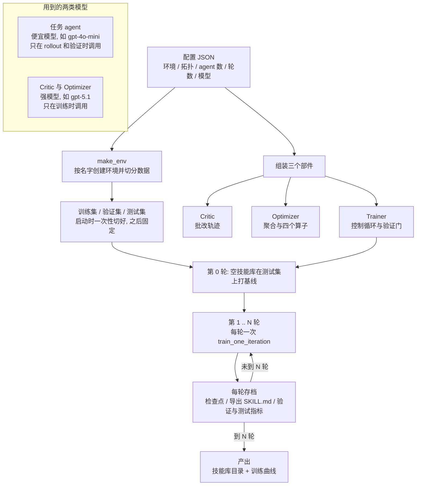
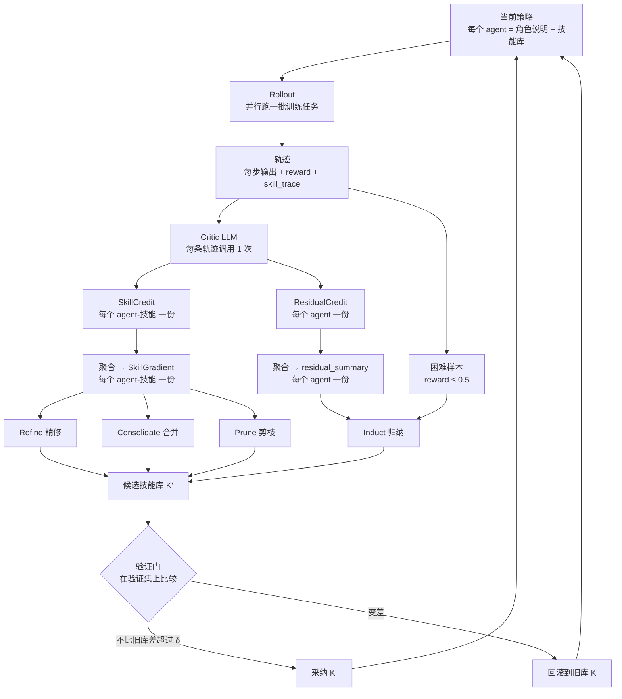
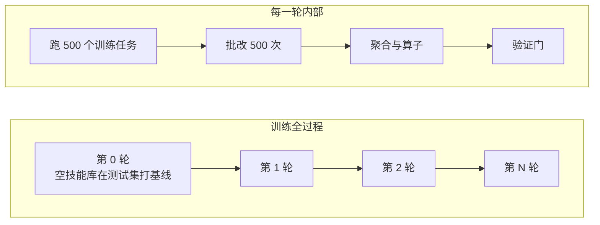
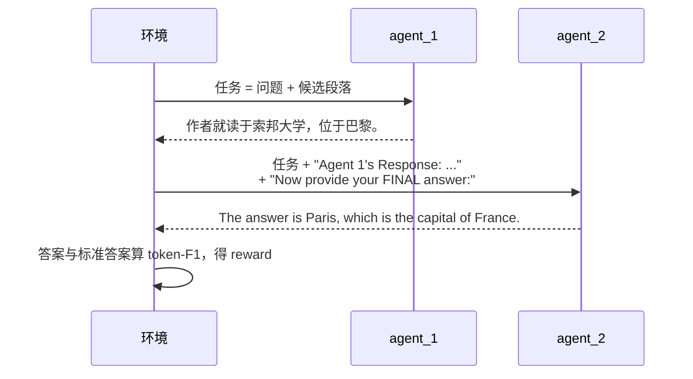
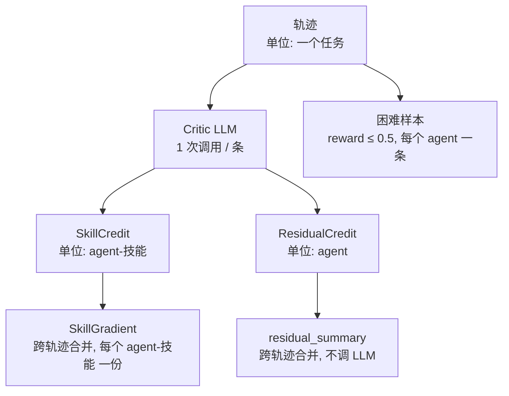
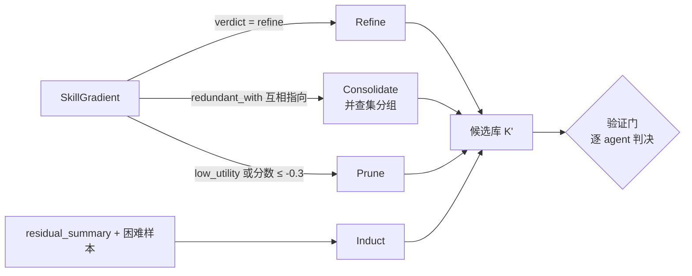
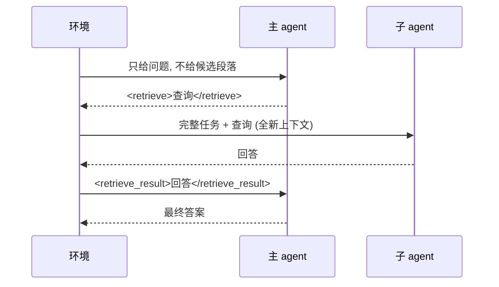
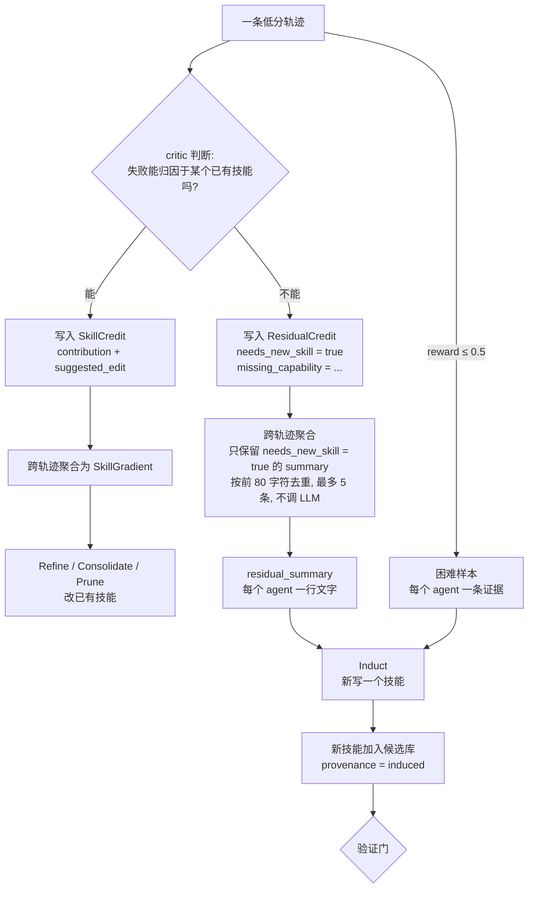

# MASkills 阅读笔记：一轮训练是怎么跑起来的

论文：*MASkills: Continual Skills Optimization for Multi-Agent LLM Systems*（arXiv 2609.02094）
代码：[DaRL-GenAI/MASkills](https://github.com/DaRL-GenAI/MASkills)（本文提到的路径均相对于仓库内的 `maskills/` 包）

> 阅读指引：先看第 1 节的总流程图，再看第 2 节的完整案例，最后用第 3 节的表格去代码里定位。案例里的任务、文本和分数是为说明流程**构造**的，字段名和流程来自真实代码。

---

## 0. 它要解决什么

多 agent 系统想从经验中持续学习。常见做法是把学到的东西都写进一个系统提示词，每次更新整体改写。问题是：改一处可能破坏别处，也没法单独评估、撤销某一条知识。

MASkills 的做法：把知识拆成**技能库**，每个技能是一个独立的 `SKILL.md` 文本文件；训练只改技能库，不改模型参数，也不改拓扑。

一条技能长这样（真实格式，内容为举例）：

```markdown
---
name: answer-short
description: Final answer must be the shortest faithful form
skill_id: answer-short
provenance: induced
utility: 0.12
invocations: 7
---
Output only the entity name or short phrase. No explanation.
```

三个关键词先记住：

| 词 | 在这里的意思 |
|---|---|
| 轨迹 | 一个任务从问题到答案的全过程记录，附带一个团队共享的 reward |
| 信用 | 强模型 critic 对"某个技能在这条轨迹里有没有帮上忙"写的评语 |
| 梯度 | 不是求导，是 LLM 写的一段"这个技能该怎么改"的文字 |

---

## 1. 总流程

### 1.0 全局流水线（从配置文件到产出）



读这张图的要点：

- **产出物只有一样东西**：训练好的技能库（`skills_autogen/iter_<i>/<agent>/<skill_id>/SKILL.md`）。部署时只需要任务 agent 加这个库，Critic 和 Optimizer 不再需要。
- 一次 `train_one_iteration` 就是下面 1.1 的那张图；全局流水线只是把它重复 N 次，前后加上"基线"和"存档"。
- 想用命令行跑：`python scripts/demo.py`，或 `maskills train --config configs/language_task/qa_hotpot_decentralized.json`。

### 1.1 一轮迭代



要点：

- 技能线（青色流向 Refine / Consolidate / Prune）和残差线（流向 Induct）是**并行**的两条路：前者处理"已有技能怎么改"，后者处理"缺了什么技能"。
- 验证门是闭环的出口：不管采纳还是回滚，下一轮都从"当前策略"重新开始。

### 1.2 三个循环层次



- 数据在启动时一次性切成**训练 / 验证 / 测试**三块，互不重叠，之后固定不变。HotpotQA 配置：训练 500、验证 200、测试 800，共 5 轮。
- **每一轮用同一批训练题、同一批验证题**，只是技能库不同。测试集只用于报告，不参与任何决策。

---

## 2. 完整案例：一个任务走完一轮

设定：HotpotQA，两个 agent，`decentralized` 拓扑。此时 `agent_2` 的库里已有一个技能 `answer-short`，`agent_1` 的库是空的。

### 步骤 1：Rollout，产生轨迹

任务 `t_042`：问题"某书作者就读的大学在哪个城市？"，标准答案 `Paris`。



reward 的计算（纯 Python，不调 LLM）：答案规范化后有 8 个词，只有 `paris` 命中，所以精确率为 $`\frac{1}{8}`$，召回率为 $`1`$，

```math
F1=\frac{2\times 0.125\times 1}{0.125+1}\approx 0.22
```

答案对了，但因为啰嗦分数很低。这是 HotpotQA 这类任务的特点：F1 对多余的词扣分。

### 步骤 2：记录技能轨迹 skill_trace

环境对每一步，在该 agent 的输出里用正则查找它库里各技能的 `name` 或 `skill_id`；**一个都没找到时，把库里全部技能都算作被调用**。

```json
{"agent_1": [{"step": 0, "skills": []}],
 "agent_2": [{"step": 1, "skills": ["answer-short"]}]}
```

`agent_2` 的输出里没出现技能名，所以走了"全部算作被调用"的分支。`agent_1` 库为空，列表为空。

### 步骤 3：Critic 批改，一条轨迹一次调用

critic 收到的是一大段文本：候选段落、问题、标准答案、每个 agent 的**完整系统提示词和输出**、最终得分，再加上"被调用的技能"清单（每个技能的 id、描述、正文前 800 字）。它被要求输出如下 JSON：

```json
{
 "skills": [
  {"agent": "agent_2", "skill_id": "answer-short",
   "contribution": "neutral",
   "evidence": "答案是 'The answer is Paris, which is the capital of France.'，F1 仅 0.22",
   "suggested_edit": "明确禁止以 'The answer is' 开头，并禁止补充解释",
   "redundant_with": [], "conflict_with": [],
   "utility_delta": -0.3}
 ],
 "residual": {
  "agent_1": {"summary": "", "needs_new_skill": false, "missing_capability": ""},
  "agent_2": {"summary": "", "needs_new_skill": false, "missing_capability": ""}
 }
}
```

- `skills` 里每一项是一个"（agent，技能）对"的评语，叫 **SkillCredit**。
- `residual` 里每个 agent 一项，叫 **ResidualCredit**，用来记录"不归任何已有技能的问题"。它是文字加布尔，**没有分数**。本例里两个 agent 都没有残差问题，所以都是空的；什么时候会有内容、之后怎么用，见第 4 节。

### 步骤 4：聚合（跨 500 条轨迹）

设 500 条轨迹里，`answer-short` 一共收到 37 份评语，其中 20 份指出"答案带引导语"。聚合分两种情况：

- 评语只有 1 份：不调 LLM，按一张对照表直接转换。
- 评语 ≥ 2 份：调一次聚合 LLM，要求"合并重复模式、化解矛盾、按出现频率加权"。

得到该技能的 **SkillGradient**：

```json
{"verdict": "refine",
 "summary": "37 条中 20 条因加入引导语或解释导致 F1 下降",
 "suggested_edit": "加入：禁止 'The answer is' 等引导语，只输出实体名或年份",
 "utility_score": -0.2}
```

残差线的聚合不调 LLM：把所有 `needs_new_skill=true` 的 `summary` 去重后拼接成一行文字（最多 5 条），得到该 agent 的 `residual_summary`。

同时，reward ≤ 0.5 的轨迹被收集成"困难样本"，每条对每个 agent 记一条证据，如 `reward=0.22; residual=...`。

### 步骤 5：算子改库

`verdict` 是 `refine`，所以交给 Refine。LLM 被要求只输出**编辑指令列表**（不允许整体重写）：

```json
[{"op": "insert_after",
  "anchor": "Output only the entity name or short phrase.",
  "old": null,
  "new": " Never start with 'The answer is'. Never add explanations."}]
```

Python 在技能正文里找到 `anchor`，按指令改写。改完后技能变成：

```markdown
Output only the entity name or short phrase. Never start with 'The answer is'.
Never add explanations. No explanation.
```

这个新版本是**候选库 K'**，还没生效。

### 步骤 6：验证门

在固定的 200 道验证题上，用团队跑两遍，算平均 F1：

| 配置 | 做法 | 假设分数 |
|---|---|---|
| 旧策略 | 两个 agent 都用旧库 | $`0.52`$ |
| 仅 agent_2 换新库 | agent_1 保持旧库 | $`0.58`$ |

判定：$`0.58\geq 0.52-0.02`$，**采纳**。`agent_1` 的库没有变化，直接视为采纳，不用再跑。若新分数低于 $`0.50`$，则 agent_2 的库回滚到旧版本。

下一轮开始时，agent_2 用的就是新版 `answer-short`。

---

## 3. 各阶段的细节

### 3.1 处理单位

读流程时最容易混的是"这一步是按什么单位处理的"：

| 阶段 | 处理单位 | 是否调 LLM |
|---|---|---|
| reward | 整条轨迹（团队共享一个数） | 否 |
| skill_trace | （agent，步）→ 技能列表 | 否 |
| Critic 批改 | 轨迹（一条一次调用） | 是 |
| SkillCredit | （agent，技能） | 来自 critic |
| ResidualCredit | agent | 来自 critic |
| 技能聚合 | （agent，技能），跨所有轨迹 | 评语 ≥ 2 条才调 |
| 残差聚合 | agent，跨所有轨迹 | 否 |
| Refine / Prune | （agent，技能） | Refine 调，Prune 不调 |
| Consolidate | agent 内部一组技能 | 是 |
| Induct | agent（每次至多新增 1 个） | 是 |
| 验证门 | agent 的**整个技能库** | 否（要跑验证集） |

每个 agent 有**自己独立**的技能库，两个 agent 里同名的技能也是两个技能。

### 3.2 批改到聚合



### 3.3 四个算子

| 算子 | 做什么 | 输入 | LLM 的输出 | 触发（默认） |
|---|---|---|---|---|
| Refine 精修 | 改已有技能的几句话 | 技能正文 + SkillGradient（verdict 为 refine） | 编辑指令列表 `{op, anchor, old, new}` | 每轮 |
| Induct 归纳 | 新写一个技能 | 现有技能列表 + 困难样本 + 残差摘要 | 完整 SKILL.md，或 `NONE` | 每 2 轮，库少于 12 个 |
| Consolidate 合并 | 把重复技能并成一个 | 互相标记冗余的一组技能 | 合并后的 SKILL.md | 每 3 轮 |
| Prune 剪枝 | 删掉没用的技能 | 每个技能的 SkillGradient | 不调 LLM；verdict 为 low_utility，或分数 ≤ $`-0.3`$ 即删 | 每 3 轮 |

调度由迭代编号决定：编号能被间隔整除，算子就启动（`OperatorSchedule`）。同一轮内执行顺序是 Refine → Consolidate → Prune → Induct。



### 3.4 验证门

对每个"库被改动过的"agent：只把它换成新库、其他 agent 保持旧库，在同一批验证题上重新跑一遍，与"全部旧库"的分数比较：

```math
\hat J_{val}(\mathcal{K}')\geq \hat J_{val}(\mathcal{K})-\delta
```

$`\delta`$ 默认 $`0.02`$，用来吸收 LLM 采样带来的分数波动。判决单位是**这个 agent 的整个库**：同一轮里对它做的所有编辑（精修、归纳、合并、剪枝）一起采纳或一起回滚。

### 3.5 拓扑与 agent 之间的通信

agent 数量很少：HotpotQA 2 个；LOCOMO 2 或 3 个（检索员 + 推理员 + 可选核验员）；GAIA 1 个或 2 个（研究员 + 解题员）。**拓扑由配置写死，不是学出来的**，训练只改技能库。agent 之间不直接通信，一切由环境用文本或正则搬运。



| 拓扑 | 通信方式 |
|---|---|
| decentralized | 顺序链：前一个 agent 的输出写入共享消息池，拼进后一个 agent 的输入；最后一个的输出是答案 |
| centralized | 如上图：主 agent 在文本里写 `<retrieve>` 标签，环境用正则抓出并调用子 agent；每次子 agent 都是全新上下文 |
| hybrid | 同 centralized，但子 agent 的历史输出会累积，下次被调用时一并告知 |

GAIA 的两 agent 版本用 `HANDOFF: ... HANDOFF_TO_SOLVER` 交接，解题员可输出 `REQUEST_MORE` 让研究员再补一次。

---

## 4. 残差（residual）详解

这是整个方法里最容易读糊涂的一块，单独讲。

### 4.1 它回答什么问题

critic 对一条轨迹要回答两个**不同**的问题：

| 问题 | 对应输出 | 用来做什么 |
|---|---|---|
| 已有的每个技能，在这条轨迹里有没有帮上忙或添乱？ | `SkillCredit`（每个 agent-技能 一份） | 决定已有技能要不要改、并、删 |
| 这条轨迹里**有没有哪里出了问题，但不是任何已有技能造成的**？ | `ResidualCredit`（每个 agent 一份） | 决定要不要**新增**技能 |

类比：回归里"模型解释不了的那部分误差"叫残差。技能信用解释的是"已有技能能解释的部分"，残差记录的是"剩下解释不了的部分"。**残差的含义是"这里可能缺一个技能"。**

### 4.2 它长什么样

```json
"residual": {
  "agent_1": {
    "summary": "把同名的两个人物当成同一个人，未做区分",
    "needs_new_skill": true,
    "missing_capability": "同名实体消歧"
  },
  "agent_2": {"summary": "", "needs_new_skill": false, "missing_capability": ""}
}
```

- `summary`：文字，说明解释不了的问题是什么。
- `needs_new_skill`：布尔，critic 判断是不是缺技能。
- `missing_capability`：文字，缺的是什么能力。
- **没有数值分数。** 数值分数（`utility_delta`）只存在于技能信用那一侧。

### 4.3 从产生到被使用的完整路径



### 4.4 一个小案例：残差如何催生新技能

设 `agent_1` 的库里没有任何"消歧"相关的技能。500 条轨迹里，有 30 条是这类题：问题涉及两个同名人物（一个作家、一个演员），agent_1 把二者混为一谈，最终答错。

1. **批改**：critic 看这 30 条时，发现问题不能归因于 `agent_1` 库里现有的任何技能（因为没有相关技能），于是在每条里写下

   `residual.agent_1 = {summary: "把同名两人混为一人", needs_new_skill: true, missing_capability: "同名实体消歧"}`

2. **残差聚合**：把这些 `summary` 去重后拼起来，得到

   `residual_summary["agent_1"] = "把同名两人混为一人 (missing: 同名实体消歧)"`

3. **困难样本**：这 30 条的 reward 都不超过 0.5，所以每条都会成为 `agent_1` 的困难样本证据，形如

   `reward=0.00; residual=把同名两人混为一人; missing=同名实体消歧`

4. **Induct**：LLM 收到的 prompt 里有"现有技能列表（避免重复）"、"Residual failure pattern: ..."、最多 6 条困难样本。它输出一个新技能：

   ```markdown
   ---
   name: disambiguate-entities
   description: 问题涉及可能重名的人或地点时，先核对描述性限定语
   ---
   适用条件：问题含人名或地名，且候选段落里出现多个同名项。
   做法：先列出各同名项及其限定语，再选与问题条件吻合的那个。
   ```

   LLM 也可以认为不需要新技能，输出 `NONE`，那就什么都不加。

5. **入库与验证**：新技能 `provenance=induced`，分配不冲突的 `skill_id`，加入 `agent_1` 的候选库，随后和其他改动一起通过验证门。

### 4.5 几个容易误解的点

- **残差和困难样本是两样东西，都喂给 Induct。**
  - 困难样本的筛选条件只看 reward ≤ 0.5，**不看** critic 是否说"需要新技能"。
  - 残差摘要只收 `needs_new_skill=true` 的文字。
  - 残差文字还会被追加到困难样本的证据里（`residual=...; missing=...`），让 Induct 看到更具体的线索。
- **残差只在 Induct 启动的那一轮才被用上。** 默认每 2 轮一次（第 2、4、6 轮）。其他轮 critic 照样生成残差，但没有算子消费它。
- **第 1 轮的特殊情况**：库是空的，没有"被调用的技能"，技能信用为空，critic 只能输出残差。但第 1 轮 Induct 不启动，所以这些残差要等到第 2 轮才被用。
- **Consolidate 和 Prune 完全不看残差**，它们只看技能这条线的 `SkillGradient`。
- **每次 Induct 每个 agent 至多新增一个技能**，且库不能超过 12 个。
- 若开启 `--evolve-role`，同一份残差文字还会用来编辑 agent 的**角色说明**（默认不开）。
- 残差是**每个 agent 一份**：同一条轨迹里，有的 agent 缺技能，有的不缺。

---

## 5. 论文符号 ↔ 代码位置

| 论文 | 含义 | 代码 |
|---|---|---|
| $`\mathcal{K}_i`$，$`k`$ | 技能库、技能 | `core/skills.py`：`SkillLibrary`、`Skill` |
| $`\xi_i`$ | 技能调用轨迹 | `core/skills.py`：`build_skill_trace`、`detect_invoked_skills` |
| $`C^{text}(\tau,k)`$ | 单条轨迹的技能信用 | `core/skill_credit.py`：`SkillCreditCritic`、`SkillCredit` |
| $`C^{text}(\tau)`$ | agent 级残差信用 | 同上：`ResidualCredit` |
| $`g`$，$`G(k)`$（Eq.6–7） | 轨迹级、批级编辑方向 | `core/skill_operators.py`：`aggregate_skill_gradients`、`SkillGradient` |
| Eq.8 动量 | 参考上一轮方向 | 发布代码中 `momentum=0.0`，未见传入上一轮 $`G`$ 的实现 |
| Eq.9 精修 | $`k\leftarrow k\oplus\Delta k`$ | `refine_skill` |
| Eq.10 归纳 | 新技能 | `induce_skill` |
| Eq.11 合并 | 合并 | `detect_redundancy_groups`、`consolidate_skills` |
| Eq.12 剪枝 | 删除 | `select_skills_to_prune` |
| Eq.13–14 验证门 | 信赖域回滚 | `trainer/skill_evolution.py`：`_validation_gate` |
| 一轮迭代 | 整体流程 | `trainer/skill_evolution.py`：`train_one_iteration` |
| 训练主循环 | 迭代、基线、评测 | `trainer/monte_carlo.py`：`train` |
| 环境与拓扑 | rollout | `envs/language/env.py`：`_collect_trajectory_decentralized` / `_centralized` |
| 奖励 | token-F1 | `envs/language/reward.py` |
| 算子调度 | 间隔表 | `OperatorSchedule` |

读代码建议顺序：`train_one_iteration`（主流程，注释按 Phase 分段）→ `skill_credit.py`（critic 的 prompt 与解析）→ `skill_operators.py`（聚合与四个算子的 prompt）→ `language/env.py`（rollout）。

---

## 6. 实验结果

设置：critic、聚合与算子用 GPT-5.1；任务 agent 用 GPT-4o-mini（HotpotQA、LoCoMo）、Qwen2.5-7B（GAIA）。

| 数据集 | 指标 | MASkills | 最强基线 |
|---|---|---|---|
| HotpotQA | F1 | 76.3 | 69.2 |
| LoCoMo 单跳 | F1 / BLEU | 27.61 / 21.30 | 26.65 / 17.72 |
| LoCoMo 多跳 | F1 / BLEU | 17.22 / 12.87 | 12.04 / 11.16 |
| GAIA | 平均 | 23.3 | 20.4 |

拓扑对比：decentralized 在 HotpotQA（76.30）和 GAIA（23.30）最好；centralized 在 LoCoMo 多跳最好（F1 22.27，对 17.22）。

消融（全模型：LoCoMo 多跳 17.2，GAIA 23.3）：

| 去掉的组件 | LoCoMo 多跳 | GAIA |
|---|---|---|
| 技能信用分配 | 14.2 | 17.1 |
| 动量平滑 | 16.4 | 21.9 |
| 验证回滚 | 6.6 | 13.5 |
| 合并与剪枝 | 13.9 | 13.0 |

去掉验证回滚掉得最多，说明 LLM 自动改写技能本身风险很高，回滚是最重要的护栏。
